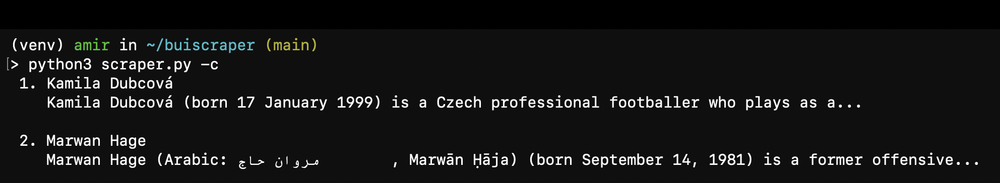
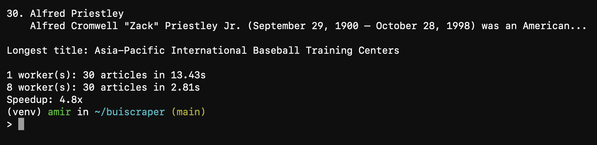
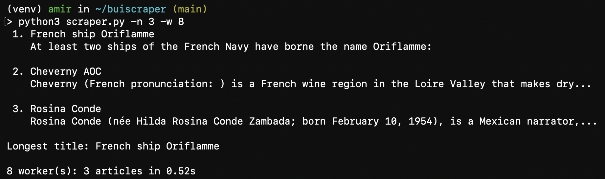

# buiscraper (software systems extra credit: part b)

A small Python scraper that fetches random Wikipedia articles and prints each title with a short intro.

## Setup

```
python3 -m venv venv
source venv/bin/activate
pip install -r requirements.txt
```

## Usage

```
python3 scraper.py                # 30 articles, 8 threads
python3 scraper.py -n 3 -w 8     # 3 articles, 8 threads
python3 scraper.py -c             # also run with 1 thread to compare and print the speedup
```

| Flag | Meaning | Default |
|------|---------|---------|
| `-n` | number of articles to fetch | 30 |
| `-w` | number of worker threads | 8 |
| `-c` | compare against a 1 thread baseline | off |

## Screenshots

Comparison run (`-c`):




Custom run (`-n 3 -w 8`):



## How it works

- `fetch` downloads one page and returns an empty string on any error.
- `parse` turns HTML into a `{"title", "intro"}` dict using BeautifulSoup.
- `scrape` builds the whole pipeline from `map` and `filter`. `reduce` finds the longest title.
- The only difference between sequential and concurrent runs is `map` vs. `ThreadPoolExecutor.map`.

## Performance

Measured with `python3 scraper.py -c` (30 articles):

| Workers | Time |
|---------|------|
| 1 | XX.XXs |
| 8 | X.XXs |
| Speedup | X.Xx |

**Concurrency:** Fetching a page is almost all waiting on the network. With `concurrent.futures.ThreadPoolExecutor`, while one thread waits, others send their own requests, so the waits overlap. That cut the time by about X.Xx. It is not a full 8x because of thread startup costs, server limits, and uneven request times (the run ends when the slowest request does).

**Functional programming:** The style itself had no noticeable speed impact. Its benefit is safety: `fetch`, `parse`, and the other helpers are pure functions that share no state, so running them in threads has no race conditions and swapping `map` for `executor.map` just works.

Threads help here because the work is I/O bound. For CPU heavy work, Python's GIL would limit them, and `ProcessPoolExecutor` would be the better choice.
